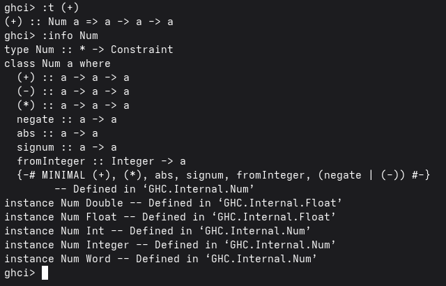
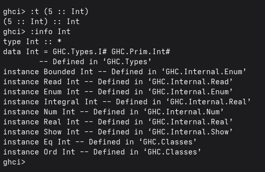

# Práctica 3: *Mis tipos de datos y listas por compresión*

---
## Objetivo

Reconocer la diferencia entre una *clase de tipo* y un *tipo de dato concreto*. Además, practicar la definición de tipos de datos propios, el uso de funciones y las listas por comprensión. Por ultimo, hecer uso de commits semánticos para los mensajes en los commits.

---
## Tiempo requerido

El tiempo requerido para realizar esta práctica fue de aproximadamente 2 horas

### Ejercicio favorito

Funcion **primos**

---
## Diferencia entre *Num* e *Int*

1) **Num:** Es una *clase de tipos* que engloba aquellos tipos que admiten operaciones numéricas, como la suma y la multiplicación. Algunos ejemplos de tipos que pertenecen a esta clase son Int, Integer, Float y Double.

2) **Int:** Es un *tipo de dato* concreto, es decir, una instancia de la clase de tipos Num. Este representa números enteros con un rango limitado y sin poder representar números decimales.

### Ejemplo

Se incluye las capturas de pantalla de ghci con la información de *Num* e *Int*



En esta captura se usa el comando :t (5 :: Int) para consultar el tipo del número 5, siendo Int, después, con :info Int, se muestra información sobre este tipo y las clases que implementa, aqui aparece Num, es decir que Int pertenece a dicha clase y puede realizar operaciones numéricas.



En esta otra captura se usa el comando :t (+) para consultar el tipo de la operación de suma, el resultado muestra Num a => a -> a -> a, lo que significa que la suma puede trabajar con valores de un mismo tipo que implemente la clase Num. 
Después, con :info Num, se muestran las operaciones que define la clase y algunos tipos que la implementan, como Int, Integer, Float y Double.

---
## Funciones 
En el archivo ***practica3.hs*** se implementaron las siguientes funciones:

- cetes: Calcula el monto final de una inversión en cetes
- mensajeCetes: Devuelve un mensaje que indica el plazo de una inversión, el rendimiento bruto obtenido y el monto final
- negativos: Cuenta los números negativos de una lista
- soloPares: Recibe una lista y devuelve otra con los números pares de la lista original
- primos: Recibe una lista y devuelve otra con los números primos de la lista original
- coprimos: Recibe un entero y devuelve una lista de los coprimos de ese entero.

En el modulo ***Auxiliar_Modulo.hs*** se implementaron las siguientes funciones:

- esParBit: Verifica si un entero es par de acuerdo a sus operaciones entre bits
- numPrimo: Verifica si un número es primo 

Todas las funciones estan comentadas dentro del mismo archivo

---
## Uso del archivo en GHCi 

Para usar las funciones se debe de abrir GHCi desde la terminal, usando:

```javascript
ghci
```

y cargar el archivo:

```javascript
:l practica3.hs
```

Después se pueden ejecutar las funciones desde el prompt de GHCi, por ejemplo:

```javascript
ghci> cetes 200 (Dias 182) 
206.98677777777777

ghci> coprimos 15
[1,2,4,7,8,11,13,14]
```
---
## Comentarios 

La función ***primos*** utiliza otra función (***numPrimo***) importada desde el mismo modulo en el que se encuentra la función ***esParBit***.